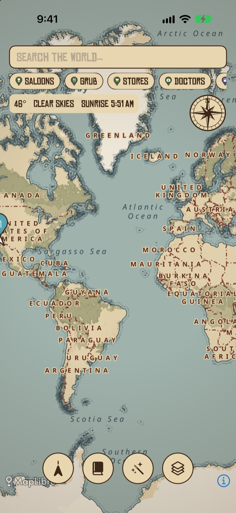
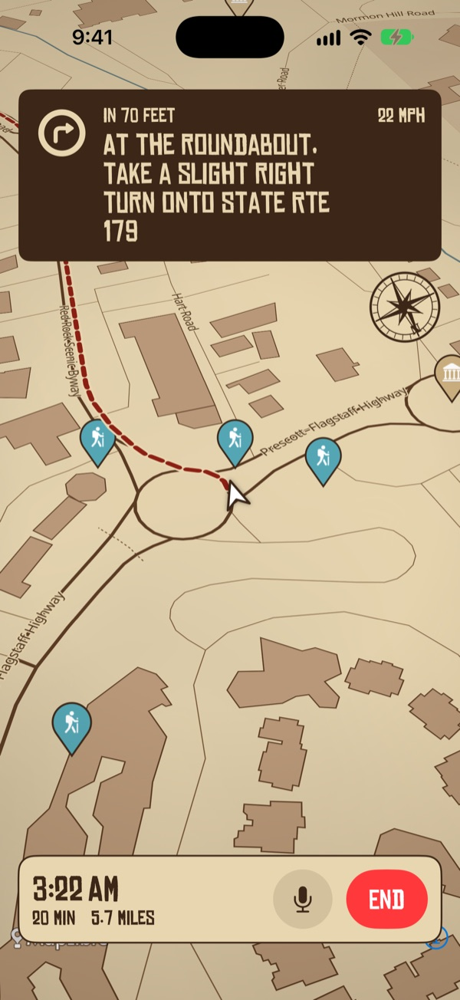
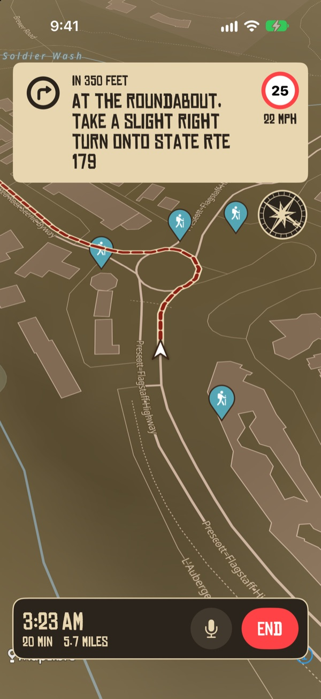

# Frontier Map

<p align="center"></p>

An iOS map of the whole world drawn in an original hand-inked, parchment Western style. It has GPS navigation, place search, saved waypoints, offline areas, fog of war and a spoken "frontier guide" who talks you through the trip in character.

Free and open source. There's no account, ads or tracking, and everything you record stays on your phone.

> **Not affiliated with Rockstar Games or Red Dead Redemption.** The style is original and only *inspired by* the look of Western game maps. It uses none of their artwork, fonts, audio or character voices.

## Screenshots

<p align="center">
  
  
  
</p>
<p align="center"><sub>The Frontier map, turn-by-turn navigation and night mode. Taken in the iOS simulator on a demo drive through Sedona, Arizona.</sub></p>

## Status

A personal project, shared as is. It builds with Xcode 26 and 27, the unit tests run in CI, and it installs and runs on a current iPhone. Many features have had little testing on a real device, so expect rough edges and please [open an issue](../../issues) when something breaks.

## What it does

**Map and search**
- **World map**: MapLibre Native + MapTiler vector tiles (OpenStreetMap data). Pick a style from the layers button: **Frontier** (the original hand-inked parchment style, `Sources/frontier-style.json`), **Modern** (MapTiler streets) or **Topo** (MapTiler outdoor: contours, hiking paths, peaks).
- **Night mode**: Auto (after sunset, or when the phone is in dark mode), Always or Never. The Frontier map gets a moonlit version made from the same style, and the controls go dark too.
- **Search with autocomplete**: suggestions as you type (addresses, businesses, categories like "coffee"), biased to where you are. With the box empty it shows **Home**, **Work** and your recent places.
- **Place details**: tap a result for its address, distance, **open now / closed** (with when it closes or opens, from OpenStreetMap hours), phone, website, Directions / Add stop / Save pin / Share, and Apple's own place card with opening hours, photos and ratings (iOS 18+).
- **Nearby finds**: chips find saloons, grub, stores, doctors, fuel, lodging and camps within 5 km.
- **Weather & daylight** chip ([Open-Meteo](https://open-meteo.com/), free, no key, non-commercial). Tap it and the guide reads it out.
- **Map furniture**: a white arrowhead turns with your heading; an engraved compass rose turns with the map (tap to face north).

**Navigation**
- **Car, Walk or Bike**, with **alternate routes** (each with its time and distance) and a **transit time** that opens in Apple Maps. Driving times include current traffic.
- **Start**: the map flies to you, tilts and follows. The turn banner shows the arrow, distance, your speed and the **posted speed limit** (OpenStreetMap, via the Overpass API); the guide warns you once if you're well over it. Turns are spoken ~300 m ahead (50 m on foot), including "take the bridge/flyover". It **re-routes** on its own, keeps talking with the **screen locked**, and **Re-center** brings you back if you pan away.
- **Road trips**: add stops from any place, or let the guide add fuel, food, coffee or a lookout near the halfway point. The Stops sheet shows arrival times at each stop and the whole day's estimate; swipe to remove, Edit to reorder.
- **Scenic route**: finds a park, beach or waterfront near the middle of the trip that adds at most 40% to the time, and offers it as another route.
- **Elevation profile** of the route, with total climb.
- **Off-grid**: with no road route (no signal, or nowhere near a road) you get a straight line and the guide calls the compass bearing and distance; it switches back to roads when it can. Save a Topo area for offline use before you go.
- **Share your ETA**, a place, or where you are. (A one-off message with the arrival time and a map link; live-updating ETA would need a server.)
- **Avoid tolls / highways** (layers sheet), applied to every route and to commute times.
- **Plain map while driving**: during car navigation the parchment map, fog and vignette give way to the clear street map; browsing and route preview keep the frontier look. Toggle in the layers sheet.
- **Favorites**: switch on Favorite in a pin's editor and it's one tap from the empty search box, next to Home and Work.
- **Leave-by alerts**: pick an arrival time and get "Leave by 8:12" on weekdays, ten minutes before you should go, from your Home pin to your Work pin using Apple's traffic forecast. Refreshed whenever you open or close the app.
- **Parking memory**: when a drive ends (any ride averaging over 25 km/h), a Parked car pin is dropped where it ended; the empty search box offers to walk you back.
- **Fuel and EV chargers along the route**: from the Stops sheet or by asking the guide.

**Ask the guide** (wand button): "plan a 3-hour drive with a lunch stop and a lookout point", "find a quiet coffee shop on my way to work". It builds the route with real stops. It reads the request with Apple's on-device model where available (needs Xcode 26 or later, and an iPhone with Apple Intelligence turned on), otherwise with keyword rules; either way nothing but place searches leaves the phone.

**Explorer**
- **Fog of war**: places you haven't been stay hazy and clear as you travel (cells of about 220 m). Toggle it in the layers sheet.
- **Weekly logbook** at the top of the Journal: distance, rides, time on the road and new discoveries in the last 7 days.
- **AI co-pilot**: tap Speak in Ask the guide (it starts listening on its own mid-trip) and say "find gas on my way", "add a coffee stop" or "what's the traffic like to work?". Speech is transcribed on the phone where iOS supports it.
- **Trail diary** in the Journal: rides log themselves (start once you've moved 200 m, end after 3 minutes still), with distance and time; tap one to see its trail on the map. Totals for miles ridden, rides, discoveries and area explored.
- **Discoveries**: parks, historic sites, scenic spots and trails near you appear as faded pins; get close and they're collected.
- **Achievements**: Greenhorn, Park Ranger, Historian, Cartographer, Legend of the Road (a famous highway) and more.
- **Waypoints**: long-press to drop a pin, pick its kind (now including Home, Work, park, viewpoint, historic site, trail), add notes and a photo. Tap a pin's popup to edit it any time; the speaker asks the guide which way.
- **Privacy**: everything above is stored only on the phone, with no account, ads or tracking, and the Journal can erase it all.

**Frontier guide voices**: pick a guide in the Journal (tap one to hear it): The Drifter (weary gunslinger, a blend of two Kokoro voices made by `scripts/blend_voice.py` at build time, pitched down), The Boss (silver-tongued gang leader), The Old-Timer (cranky prospector), Deacon Hollis (gravel-voiced tracker), Sadie Reed (widowed homesteader) or Kid Larkin (young rider). Frontier words like "ridin'" and "'bout" get proper pronunciations from `scripts/dialect_lexicon.py` at build time. Original characters in the spirit of outlaw westerns, each with their own lines and a natural on-device AI voice ([Kokoro](https://huggingface.co/hexgrad/Kokoro-82M) via [sherpa-onnx](https://github.com/k2-fsa/sherpa-onnx), both Apache-2.0, offline). The model (~170 MB) is downloaded at build time, not stored in git; without it the app falls back to the built-in iOS voice.

**Not included**, and why:
- **Lane guidance**: Apple's routing API doesn't expose lanes.
- **CarPlay**: needs a CarPlay navigation entitlement from Apple, which a free Apple ID can't get.
- **Live traffic on the map**: only the ETA includes traffic; there's no free traffic layer.
- **Live ETA sharing, time saved by reroutes, "open now" filtering**: need a server, or data Apple's API doesn't give.
- **Community spots and upvotes**: needs a shared server and moderation. Pins with notes and photos are the on-phone version for now.

## What you need

| What | Cost | Why |
|---|---|---|
| A Mac with [Xcode](https://apps.apple.com/app/xcode/id497799835) 26 or later | Free | Building the app. No Mac? See [Building without a Mac](#building-without-a-mac). |
| An iPhone on iOS 16 or later | | Running it. The simulator works too, but has no compass. |
| A [MapTiler](https://cloud.maptiler.com) account and API key | Free tier (monthly request limit) | Map tiles, hillshade and label fonts |
| An Apple ID | Free | Signing the app for your own iPhone |
| Optional: Apple Developer Program | $99/year | Installs stop expiring after 7 days, and you can use TestFlight |

There's no App Store version. You build and install it yourself, which takes about 15 minutes the first time.

## Install on your iPhone

1. **Get the tools.** Install Xcode from the App Store, open it once and let it finish setting up. Then install [Homebrew](https://brew.sh) if you don't have it, and run `brew install xcodegen`.
2. **Get the code.**
   ```sh
   git clone https://github.com/002478186/frontier-map.git
   cd frontier-map
   cp Config/Secrets.example.xcconfig Config/Secrets.xcconfig
   ```
3. **Fill in `Config/Secrets.xcconfig`.** It's gitignored, so nothing in it gets committed.
   - `MAPTILER_KEY`: create a key at [cloud.maptiler.com](https://cloud.maptiler.com) › API keys.
   - `FRONTIER_BUNDLE_ID`: any ID nobody else uses, like `com.yourname.frontiermap`. Apple won't sign an ID that another account has already registered.
   - `DEVELOPMENT_TEAM`: your 10-character team ID. To find it, sign in to your Apple ID in Xcode › Settings › Accounts. Then run `xcodegen generate`, open `FrontierMap.xcodeproj`, select the FrontierMap target › Signing & Capabilities, choose your "(Personal Team)" and read the ID from the Team field. For paid accounts it's also on [developer.apple.com/account](https://developer.apple.com/account) › Membership.
4. **Prepare the iPhone.** Plug it in by cable, unlock it and tap **Trust**. Then turn on Settings › Privacy & Security › **Developer Mode**; the phone restarts.
5. **Build and install.**
   ```sh
   scripts/install-iphone.sh
   ```
   The first run downloads the guide's voice model (~170 MB) and takes a few minutes. After that it takes under a minute.
6. **Trust the app** the first time: on the iPhone, open Settings › General › VPN & Device Management, tap your Apple ID and tap **Trust**.

**With a free Apple ID the app stops opening after 7 days.** Plug the phone in and run `scripts/install-iphone.sh` again. Your pins, diary and other data are kept.

### Run in the simulator instead

Do steps 1–3 (you can leave `DEVELOPMENT_TEAM` empty). Then run `xcodegen generate`, open `FrontierMap.xcodeproj`, pick an iPhone simulator and press ⌘R. To get the guide voices, first fetch `Kokoro/` and `Frameworks/`, either by running the install script once or by running the commands in the "Fetch Kokoro" step of `.github/workflows/ios.yml`. Fake your location with Simulator › Features › Location › Custom Location. Run the tests with ⌘U.

## Your MapTiler key

The key is never in the source code. `Config/Base.xcconfig` holds only the placeholder `YOUR_MAPTILER_KEY`, and the real key goes in your gitignored `Config/Secrets.xcconfig` (or a CI secret, below). The app reads it from its Info.plist at runtime. Without a key the app still builds and shows "No MapTiler key set".

Any key built into an app can be pulled out of the app file by someone determined. So:
1. don't share your built app (`.app`, `.ipa` or simulator `.zip`) publicly;
2. use a key just for this app, and turn on the restrictions MapTiler offers for it;
3. keep an eye on usage in the MapTiler dashboard, and regenerate the key if it leaks.

## Building without a Mac

GitHub Actions can build it on a cloud Mac for you.

1. Make your own **private** copy. Don't fork it: a fork of a public repo is public, and the builds contain your key. Either use GitHub's [importer](https://github.com/new/import) with this repo's URL and choose Private, or create an empty private repo and push a clone of this one to it.
2. In your copy, go to Settings › Secrets and variables › Actions › **New repository secret**, name it `MAPTILER_KEY` and paste your key.
3. Every push starts **Actions › iOS**, and you can also run it by hand. It builds the app, runs the tests and records a simulated drive. On a private repo it uploads `FrontierMap-unsigned.ipa` and `FrontierMap-simulator.zip` as the `FrontierMap-builds` artifact.
4. **Windows:** install Apple's **Apple Devices** app from the Microsoft Store, then [Sideloadly](https://sideloadly.io). Drag in the `.ipa` and sign in with your Apple ID; it's a third-party tool, so consider a secondary Apple ID. On the iPhone, turn on Developer Mode and trust your Apple ID as in steps 4 and 6 above. Re-sideload every 7 days.
5. **Try it in a browser:** upload the simulator `.zip` to [Appetize.io](https://appetize.io) (free tier). This hands your key-containing build to a third party.

macOS minutes on private repos count 10× against GitHub's free allowance.

## Permissions

- **Location, When In Use**: asked the first time the map shows your location. It's used on-device for the arrow, the trail diary, fog of war and discoveries. While a route is running it keeps updating with the screen locked (the blue indicator shows), and stops when the route ends. Coordinates are sent to Apple Maps, MapTiler, Open-Meteo and Overpass only to answer searches, tiles, weather/elevation, speed limits and opening hours. If you deny it, the map and search still work, and the follow button tells you how to re-enable location.
- **Photos**: only the photo you pick for a pin, through the system picker (no library access). No contacts. Everything stays on the phone and isn't synced.
- **Microphone and speech recognition**: only when you tap Speak (or open Ask the guide mid-trip).
- **Notifications**: only if you turn on leave-by alerts.

## Limitations

- **Global coverage**: the whole world is mapped, but detail depends on OpenStreetMap. Cities are rich, while rural areas and some countries are sparse. Labels show in Latin script (e.g. "Tokyo", not "東京").
- **Connectivity**: the map streams tiles and search needs internet. Places you've recently viewed stay in MapLibre's small automatic cache, but don't rely on that.
- **Offline**: only areas you explicitly saved work offline, and only down to the zoom you saved (max 15). Downloads count against your MapTiler quota. Large areas take many tiles, so save regions, not countries. Check MapTiler's terms for offline use on your plan. If you change the key, previously saved areas stop matching and must be re-saved. Search and the guide's directions don't need the map, but search does need a connection.
- **Directions**: needs a connection and your location. Apple routing doesn't cover every country, and you'll see "No trail found" where it doesn't. Bike routes use Apple's walking routes timed at 16 km/h; Apple's cycling directions aren't used yet. Transit is a time estimate that opens Apple Maps. Speed limits are only as good as OpenStreetMap's tags near you.
- **Look**: this is a styled vector map (parchment colors, inked lines, vignette), not hand-painted artwork. A closer "painted" look would need original illustrated textures and icons (`fill-pattern`, custom sprites), which could be added later.
- **Map style untested**: layer and field names follow the OpenMapTiles schema that MapTiler serves. If the hillshade source or a font name doesn't resolve, that layer simply won't draw.

## Project layout

```
project.yml                  XcodeGen spec (generates the .xcodeproj)
Config/                      defaults + your own Secrets.xcconfig (gitignored)
Sources/FrontierMapApp.swift app entry
Sources/ContentView.swift    main screen: search, turn banner, route panel, tools
Sources/Sheets.swift         pin editor, place details, layers, assistant, stops, elevation, Journal, turns
Sources/MapView.swift        MapLibre map, styles + night style, pins, route/trail layers
Sources/AppModel.swift       state: routes, trips, discoveries, achievements, search, offline
Sources/Navigation.swift     Route (multi-leg), StepTracker, path sampling
Sources/Planner.swift        trip assistant: request parsing (+ Apple on-device model)
Sources/Explorer.swift       on-device storage, trip recorder, fog, discoveries, achievements
Sources/Lookups.swift        speed limits and opening hours (Overpass), elevation (Open-Meteo), share links
Sources/Waypoints.swift      waypoints, pin kinds, geometry
Sources/Weather.swift        Open-Meteo weather
Sources/Guide.swift          guide characters and speech
Sources/Kokoro.swift         on-device neural voice
Sources/Markers.swift        pins, player arrow, compass rose, fog overlay, speed sign
Sources/frontier-style.json  the Western map style
Tests/                       unit tests
.github/workflows/ios.yml    CI: build, tests, simulated drive
scripts/install-iphone.sh    build, sign and install on a plugged-in iPhone
scripts/blend_voice.py       makes the Drifter's voice from two Kokoro voices
scripts/dialect_lexicon.py   teaches Kokoro the guides' frontier words
design/app-icon.svg          app icon source (export at 1024×1024, no transparency)
design/icon-reveal/          HyperFrames animation of the icon (npx hyperframes render), shown as design/icon-reveal.gif
design/screenshots/          README screenshots (simulator demo drive: -from / -demo launch arguments)
```

## Credits and licenses

Frontier Map's own code and map style are [MIT licensed](LICENSE). It builds on:

- [MapLibre Native](https://github.com/maplibre/maplibre-native) (BSD-2-Clause) for the map engine
- [MapTiler](https://www.maptiler.com) tiles and [OpenStreetMap](https://www.openstreetmap.org/copyright) data. © MapTiler © OpenStreetMap contributors; the map's ⓘ button shows the attribution.
- [Kokoro-82M](https://huggingface.co/hexgrad/Kokoro-82M) (Apache-2.0) and [sherpa-onnx](https://github.com/k2-fsa/sherpa-onnx) (Apache-2.0) for the guide voices. They're downloaded at build time, not stored in this repo.
- [Open-Meteo](https://open-meteo.com) for weather and elevation (free for non-commercial use), and the [Overpass API](https://overpass-api.de) for speed limits and opening hours
- Apple MapKit for search and routing
- "Chinese Rocks" font by Ray Larabie (freeware, redistributable but not for profit; see `Sources/Fonts/ChineseRocks-LICENSE.txt`)

Because of the font license and Open-Meteo's terms, don't sell builds of this app without replacing those pieces first.
